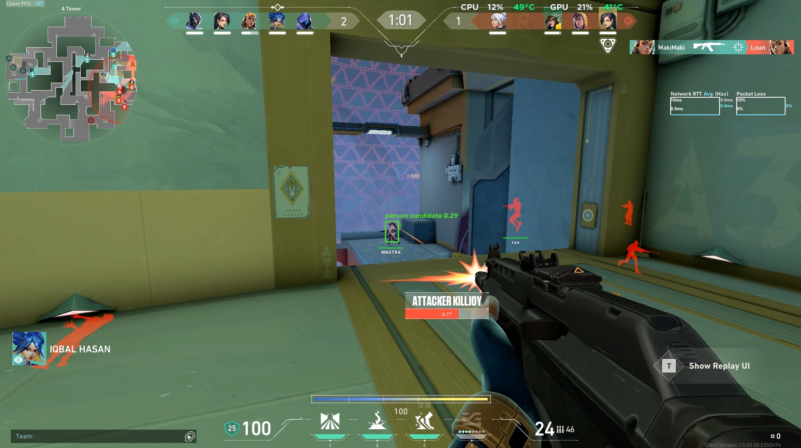
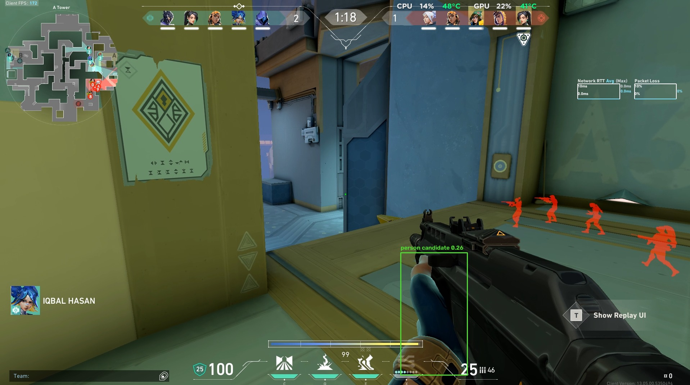
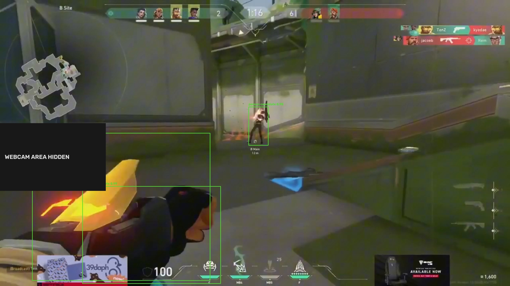

# VantaSight

### Visual analytics for recorded FPS footage

VantaSight is a computer-vision research project. The first target is Valorant footage; the input and analytics pipeline should remain reusable for other FPS or online games later. It aims to measure candidate detections, visible body-region estimates, tracking quality, and crosshair alignment. It does not control a game or automate player input.

VantaSight analyzes recorded screenshots and video offline. The current prototype includes a COCO person-candidate detector, experimental body-region estimates, temporary box tracking, crosshair-distance measurements, CSV/JSON export, a separate report dashboard, and manual-label evaluation tools. It does not determine enemy/team identity reliably; model accuracy on the supplied footage still requires manual annotations and evaluation.

## Example offline previews

These previews come from the local `ss-1`, `ss-2`, and `vd-1` samples. Green boxes are generic COCO person candidates, not verified enemy detections or accuracy results. The video preview's webcam inset was covered after inference for sharing; the detector boxes were produced before that cover was added.

| `ss-1`: a candidate overlaps the in-world character | `ss-2`: the candidate is a first-person arm/weapon false positive |
|---|---|
|  |  |

`vd-1`, source frame 3000 (25 seconds): the in-world character receives a candidate, while large candidates also overlap foreground/stream content. The webcam inset is hidden in this shared copy.



## Requirements

- Python 3.11 or newer (the current development environment uses Python 3.13)
- The dependencies in `requirements.txt`

## Setup on Windows (PowerShell)

```powershell
py -3.13 -m venv .venv
.\.venv\Scripts\Activate.ps1
python -m pip install --upgrade pip
python -m pip install -r requirements.txt
python -m pip install -e .
```

If Python 3.13 is unavailable, create the environment with another supported Python version, for example `py -3.11 -m venv .venv`.

For person-candidate detection, install the matching PyTorch and TorchVision versions. The current RTX 3050 setup uses CUDA 12.8:

```powershell
python -m pip install -r requirements-vision.txt --index-url https://download.pytorch.org/whl/cu128
```

For a CPU-only environment, use PyTorch's CPU wheel index instead:

```powershell
python -m pip install -r requirements-vision.txt --index-url https://download.pytorch.org/whl/cpu
```

## Inspect an input file

```powershell
python -m vantasight "C:\path\to\screenshot.png"
python -m vantasight "C:\path\to\recording.mp4"
```

The command reports image dimensions or video dimensions, FPS, duration, and frame count. The reusable input API is under `src/vantasight/input/`.

## Local footage folders

- Put screenshots in `data/input/screenshots/`.
- Put recorded videos in `data/input/videos/`.
- Keep the IDs you assign in the filenames: `vd-1.mp4`, `vd-2.mp4`, `ss-1.png`, `ss-2.jpg`, and so on. Video IDs (`vd-N`) and screenshot IDs (`ss-N`) each have their own sequence. Preview filenames retain the video ID, for example `vd-1_frame_000120.png`.
- These input folders are ignored by Git, so your media will not be included in a normal commit or pushed to GitHub. Do not use `git add -f` on media unless you intentionally want to upload it.

## Save a frame preview

Extract a zero-based frame index from a video. By default, the preview is saved under `data/previews/`:

```powershell
python -m vantasight "data/input/videos/vd-1.mp4" --frame-index 120
```

Choose a custom output path if needed:

```powershell
python -m vantasight "data/input/videos/vd-1.mp4" --frame-index 120 --output "data/previews/vd-1_frame_000120.png"
```

## Run the baseline person detector

The optional detector reports COCO `person` candidates. It does not identify enemies or teams. The first detection run downloads the documented TorchVision COCO_V1 checkpoint; see [the model card](docs/MODEL_CARDS.md).

```powershell
python -m vantasight "data/input/screenshots/ss-1.png" --detect-persons
python -m vantasight "data/input/screenshots/ss-2.png" --detect-persons
python -m vantasight "data/input/videos/vd-1.mp4" --frame-index 3000 --detect-persons --max-side 2560 --exclude-region 0,620,530,960
```

Annotated previews go to `data/previews/` by default. `--max-side` controls internal detector resizing; reported bounding boxes map back to the original input resolution. Add `--preserve-source-resolution` to run detector inference at the input's original pixel dimensions instead of TorchVision's normal resize; this overrides the configured `--max-side` for that input. This can help retain detail around small, distant candidates, but uses more GPU memory, runs more slowly, and can exhaust memory. It does not guarantee better detection; compare only runs with the same resize mode and verify them against manually reviewed labels. The flag is available on the CLI, image/video analysis, tracking, and evaluation commands; AP and threshold-sweep reports record the selected mode. Per-file exclusion rectangles are stored in the local, Git-ignored `data/annotations/source_regions.json`; the default file is loaded automatically by source filename. For one-off adjustments, repeat `--exclude-region x1,y1,x2,y2`. Region coordinates use source pixels, so each video or screenshot needs its own coordinates. These masks skip candidate boxes whose centers fall inside the marked areas; they do not crop or resize the source file.

See [docs/WORKFLOW.md](docs/WORKFLOW.md) for the step-by-step roadmap, current progress, and plain-language notes about each component.

## Manually label opponent boxes

Use the local annotation tool to create review labels for selected recorded-video frames. First create a time-spread shortlist from the tracking report, then review its frames. The annotation tool verifies that the shortlist fingerprint belongs to the exact video before opening any frame:

```powershell
python tools/create_review_shortlist.py reports/vd-1_dashboard_tracks_dense.json --output reports/vd-1_manual_review_shortlist.csv
python tools/annotate_video_frames.py "data/input/videos/vd-1.mp4" --shortlist-csv reports/vd-1_manual_review_shortlist.csv --dry-run
python tools/annotate_video_frames.py "data/input/videos/vd-1.mp4" --shortlist-csv reports/vd-1_manual_review_shortlist.csv
```

No `vd-1` video annotations have been verified; the old provisional labels were removed. The `--dry-run` option checks the shortlist fingerprint and decodes every selected frame without opening a window or writing labels. Start the interactive tool only when you are ready to inspect the actual annotation window and label frames yourself. Each unsaved frame starts blank; previously saved manual rows are skipped. On Windows, after setting up `.venv` and placing the local video in `data/input/videos/vd-1.mp4`, you can double-click `tools/start_vd1_annotation.bat` to launch the 12-frame review; it performs this preflight first. If the shortlist CSV is missing but the dense tracking report exists, the launcher creates the CSV automatically; if the report is missing, it prints the command to generate it. The console names the expected window title prefix (`VantaSight annotation - vd-1.mp4 frame`) and stays open if the tool reports an error. The launcher keeps the annotation window above other windows to make it easier to find. If an earlier annotation window is already open, close it with `q` first to avoid duplicate sessions. For direct command-line use, add `--keep-on-top` if the window opens behind other applications.

```powershell
python tools/annotate_video_frames.py "data/input/videos/vd-1.mp4" --shortlist-csv reports/vd-1_manual_review_shortlist.csv --dry-run
python tools/annotate_video_frames.py "data/input/videos/vd-1.mp4" --shortlist-csv reports/vd-1_manual_review_shortlist.csv --output data/annotations/vd-1_user_verified.jsonl
```

Inspect every frame, press `y`, `n`, or `u` yourself, draw boxes when an opponent is visible, then press `Enter` to save. Press `c` to clear boxes if needed. Saved records include `reviewed_manually: true` and a SHA-256 fingerprint of the decoded source frame. Evaluators reject annotations whose frame fingerprint no longer matches; older annotations without a fingerprint remain supported.

The preview initially fits the frame in the window; saved coordinates always use the original video pixels. Use `+`/`-` to zoom around the current view, `0` to reset to the whole frame, and right-drag to pan. On Windows, the mouse wheel also zooms at the cursor. In box mode (`r`), drag around each visible in-world opponent. Do not label the streamer inset, teammates, first-person hands/weapons, HUD, or replay silhouettes as opponents. Use `u` if the frame is ambiguous. Press `y` to mark an opponent visible, `n` for none visible, and `Enter` to save and continue. Use `z` to undo the latest box, `c` to clear, and `q` to stop; saved rows remain. Optional body-region points can be added inside the selected opponent box: press `1` for head, `2` for chest, `3` for lower torso, or `4` for legs, then click the region center. Use `[` and `]` to select a different opponent box. Labels append to the local, Git-ignored `data/annotations/manual_enemy_boxes.jsonl` file.

After labeling, calculate offline detection metrics with:

```powershell
python tools/evaluate_detector.py "data/input/videos/vd-1.mp4" --confidence-threshold 0.25 --iou-threshold 0.50
```

For a planned frame sample, optionally require exact annotation coverage with `--expected-frames 540,1080,1650,1800,3030,3210,3840,4650,4890,4980,6090,6480`; the evaluator reports missing or extra indexes before inference.

Compare multiple cutoffs from one detector pass with:

```powershell
python tools/evaluate_threshold_sweep.py "data/input/videos/vd-1.mp4" data/annotations/vd-1_user_verified.jsonl --expected-frames 540,1080,1650,1800,3030,3210,3840,4650,4890,4980,6090,6480 --output reports/vd-1_threshold_sweep.csv
```

The default sweep covers confidence `0.25` through `0.95` in `0.05` increments. The CSV includes positive/negative scored-frame counts, ground-truth box count, and annotation provenance. It also reports recall at each threshold for ground-truth boxes grouped by their height as a fraction of the source frame: tiny `<2%`, small `2–6%`, medium `6–16%`, and large `>=16%`. Empty groups have blank recall; false positives remain in the overall metrics because they have no ground-truth target size. The dashboard summarizes these size recalls at the lowest reported confidence threshold. The evaluator requires manually reviewed annotations unless `--allow-unreviewed-labels` is explicitly passed for exploratory analysis. It reuses detections across cutoffs, so each labeled frame runs through the model once.

To evaluate confidence-ranked box localization over IoU thresholds `0.50` through `0.95` in `0.05` increments, use:

```powershell
python tools/evaluate_iou_ap.py "data/input/videos/vd-1.mp4" data/annotations/vd-1_user_verified.jsonl --expected-frames 540,1080,1650,1800,3030,3210,3840,4650,4890,4980,6090,6480 --output reports/vd-1_iou_ap.csv
```

The report uses 101-point interpolated AP, matching each prediction to at most one ground-truth box in its own frame. It records model/weights, confidence floor, resize limit, device, exclusion-region count, and AP method. It is a small-sample research metric, not the full COCO evaluation protocol (which also defines max-detection and area rules). Unreviewed annotations require `--allow-unreviewed-labels` and remain marked exploratory.

Load the confidence sweep and IoU AP report beside the matching video report in the offline dashboard; the AP curve is graphed by IoU threshold:

```powershell
python tools/open_dashboard.py reports/tracks.json --threshold-sweep reports/vd-1_threshold_sweep.csv --iou-ap reports/vd-1_iou_ap.csv
```

The evaluator reports per-frame true positives, false positives, false negatives, precision, and recall. Uncertain frames are skipped. It requires manual annotations and writes its CSV under the Git-ignored `reports/` folder.

By default, detector and pose evaluators require records saved from the interactive annotation tool, which marks each manually reviewed row. For an explicitly exploratory run on provisional or legacy rows, pass `--allow-unreviewed-labels`; the output labels that provenance and warns that the metrics are not a reviewed ground-truth benchmark.

Evaluate screenshot-level candidate presence against the manually labeled screenshots:

```powershell
python tools/evaluate_screenshot_presence.py --confidence-threshold 0.25
python tools/evaluate_screenshot_presence.py --thresholds 0.25,0.26,0.28,0.30,0.35,0.40 --output reports/screenshot_presence_threshold_sweep.csv
```

This compares whether any person candidate was returned with the user-labeled enemy-visible yes/no value; it does not evaluate box overlap, enemy identity, tracking, or aim accuracy. `--thresholds` evaluates several cutoffs from one inference pass and writes one row per screenshot and threshold, including the source image SHA-256. The current two-screenshot result is only an exploratory pilot and must not be generalized to gameplay footage.

If you marked body-region points, compare the COCO pose model against them with:

```powershell
python tools/evaluate_pose_regions.py "data/input/videos/vd-1.mp4"
```

This reports pixel and frame-normalized localization errors and coverage. Missing estimates reduce coverage; they are not assigned guessed coordinates.

## Track candidates in a recorded video

Run short-term box association offline and export sampled detections with temporary IDs and image-plane velocity:

```powershell
python tools/track_video.py "data/input/videos/vd-1.mp4" --frame-step 30 --preview-frame 3000
```

For small/distant targets, use source-resolution inference when the GPU has enough memory:

```powershell
python tools/track_video.py "data/input/videos/vd-1.mp4" --frame-step 30 --preserve-source-resolution
```

The JSON report records whether this mode was selected. AP evaluation accepts the same option, and its CSV stores the choice so reports can be compared using matching inference scales.

Add experimental body-region estimates and geometric alignment measurements when desired:

```powershell
python tools/track_video.py "data/input/videos/vd-1.mp4" --frame-step 30 --estimate-body-regions --measure-alignment
```

Use `--crosshair x,y` to set a different reference in source-image pixels. Pose estimates are matched to candidate boxes by one-to-one IoU (`--pose-match-iou-threshold` changes the minimum overlap); unmatched pose observations remain unassociated. `--pose-person-threshold` filters pose-model person detections, while `--keypoint-score-threshold` filters raw keypoint heatmap values. These are distinct scores. The keypoint model is COCO-trained, and its raw keypoint scores are not calibrated confidence values. Alignment is a geometric offset, not hit probability or aim accuracy.

The frame step is in source frames. Unsampled video frames are skipped with indexed seeks while recorded frame indexes and timestamps remain tied to the original video. Use `--start-frame` and exclusive `--stop-frame` to analyze a segment. Results go to `reports/tracks.csv` and the structured `reports/tracks.json`; use `--output` and `--json-output` to choose other paths. The JSON report includes video metadata, analysis settings, per-frame detections, temporary IDs, image-plane velocity, runtime statistics, and descriptive temporary-track observation counts and observed spans. These spans cover sampled observations only and do not prove continuous presence or identity. An optional preview goes to `data/previews/`. IDs associate boxes only, can fragment when detections disappear or change shape, and do not identify players, teams, or enemies. Velocity is measured in source-image pixels per second, not game-world speed.

Open a saved report in the separate offline dashboard. Its window title includes both the source filename and report name so you can distinguish different analyses of the same video:

```powershell
python tools/open_dashboard.py reports/tracks.json
```

The dashboard loads the report and its local source media, lets you browse sampled video frames or a single screenshot, and draws recorded candidate boxes, temporary IDs, pose points, and alignment references when present. New analysis reports include a SHA-256 fingerprint of the exact source file; the dashboard checks it before displaying results and rejects a same-named file if its contents changed. AP and confidence-sweep CSVs also include this fingerprint, and the dashboard checks that they match the tracking report. Older reports without a fingerprint remain supported. Hashing reads the source file when analyzing, evaluating, and opening the report, which can take a moment for large videos. Use Play samples, Pause, and Stop to review a video's analyzed frame sequence; playback advances only through sampled frames. The **Analyze local media** panel lets you choose an image or recorded video and shows dimensions plus video FPS/duration before running. Videos use the configured source-frame sampling interval and can be paused/resumed or cancelled; screenshot inference runs as one operation and cannot be paused mid-inference. Either can optionally enable experimental body-region and alignment estimates. Blank **Crosshair x,y** uses the source-frame center; a custom `x,y` value is in source-image pixels from the top-left and must lie inside the selected frame. The dashboard opens the new report on completion. Video reports record user-paused seconds separately and exclude those waits from throughput. Reports summarize detector candidate confidence (min/mean/median/p95/max) separately from evaluation metrics; these scores are not hit probability or accuracy. They also summarize mean keypoint heatmap responses by estimated body region. These raw model responses are not calibrated confidence or localization accuracy and may exceed 1. The dashboard shows detector and pose evaluation only when you explicitly pass `--detector-evaluation` or `--pose-evaluation`; it does not auto-load files from `reports/`. AP and confidence-sweep summaries likewise require explicit `--iou-ap` or `--threshold-sweep` paths. Only provide reports based on manually verified labels when you want them presented as accuracy-related results. Pass `--image path\to\source.png` or `--video path\to\source.mp4` when opening a report whose source is outside the corresponding input folder. It does not capture the desktop or interact with a game.

The dashboard also summarizes sampled frames where the detector returned no person candidates, including the longest run of adjacent report samples. This is a model-output gap summary only; it does not establish that no enemy was present.

For `vd-1`, create a denser dashboard report: at 120 FPS it samples every 30 source frames (0.25 seconds) and preserves the 2560×1440 source resolution so small targets retain their input detail:

```powershell
.\.venv\Scripts\python.exe tools\track_video.py "data/input/videos/vd-1.mp4" --frame-step 30 --preserve-source-resolution --output "reports/vd-1_dashboard_tracks_dense.csv" --json-output "reports/vd-1_dashboard_tracks_dense.json"
```

On Windows, double-click `tools/start_vd1_dashboard.bat` to open that local `vd-1` tracking report. The launcher intentionally does not load the older provisional confidence-sweep or IoU/AP files because their labels were never user-verified. The tracking report shows model candidates, not validated enemy detections. The launcher checks that the virtual environment, source video, and dense tracking JSON exist. If it is missing, it prints the command above. Source-resolution analysis uses more GPU memory and time; it is still an offline sample and can miss appearances shorter than the 0.25-second interval. Inputs and generated reports stay local and are ignored by Git.

To see how tall the detector's candidate boxes are relative to the source frame, summarize any saved tracking report:

```powershell
python tools/summarize_candidate_sizes.py reports/vd-1_dashboard_tracks_dense.json --output reports/vd-1_candidate_size_by_frame.csv
```

The CSV has one row per sampled frame, including frames with no candidate. It groups predicted box heights as tiny `<2%`, small `2–6%`, medium `6–16%`, and large `>=16%` of source-frame height. These are model candidate sizes only; they do not identify enemies or measure small-enemy recall. The report and CSV remain local and are ignored by Git.

To prepare a time-spread manual-review shortlist from a tracking report, select the smallest model candidate in each time bin and one frame with zero model candidates where available:

```powershell
python tools/create_review_shortlist.py reports/vd-1_dashboard_tracks_dense.json --bins 6 --output reports/vd-1_manual_review_shortlist.csv
```

The CSV records source frame indexes, timestamps, candidate counts, and why each frame was selected. A zero-candidate frame does not prove that no enemy is visible, and a small candidate does not prove an enemy was detected. Use the frame indexes only as places to inspect manually; this tool creates no labels and performs no evaluation.

Analyze one screenshot directly if needed:

```powershell
python tools/analyze_image.py "data/input/screenshots/ss-1.png" --estimate-body-regions --measure-alignment --output reports/ss-1.csv --json-output reports/ss-1.json
python tools/open_dashboard.py reports/ss-1.json
```

## Experimental body-region estimate

The optional COCO Keypoint R-CNN experiment can be run on a screenshot or one selected video frame:

```powershell
python -m vantasight "data/input/videos/vd-1.mp4" --frame-index 3000 --estimate-body-regions --max-side 1920
```

It draws visible keypoints and coarse head/chest/lower-torso/leg centers to `data/previews/`. These are geometric estimates from COCO pose keypoints, not Valorant-trained anatomy labels. TorchVision's keypoint heatmap response is a raw score, not a probability or calibrated confidence; missing regions remain unreported. See [the model card](docs/MODEL_CARDS.md).

Measure alignment from the frame-center reference, or configure one in source-image pixels. The standalone screenshot analyzer accepts the same optional reference:

```powershell
python -m vantasight "data/input/screenshots/ss-1.png" --estimate-body-regions --measure-alignment
python -m vantasight "data/input/screenshots/ss-1.png" --estimate-body-regions --measure-alignment --crosshair 959,536
python tools/analyze_image.py "data/input/screenshots/ss-1.png" --estimate-body-regions --measure-alignment --crosshair 959,536
```

The CLI reports pixel distance and distance divided by the frame diagonal for each available estimated region. This is geometry only; it is not hit probability, enemy identification, or an instruction to move aim. A red cross in the preview marks the reference point.

Track sampled candidate boxes in an offline video with [the tracking tool](tools/track_video.py). Its IDs are temporary associations, and its speed values are measured in source-image pixels per second.

## Current scope

- PNG, JPEG, BMP, and WebP screenshots
- Video formats supported by the installed OpenCV build (commonly MP4, AVI, and MOV)
- Frame indices and timestamps are represented in the video input API
- No game-process access, overlays injected into a game, input automation, or aim control

## Run the project checks

From the repository root, run the unit tests and compile check:

```powershell
python -m unittest discover -v
python -m compileall -q src tools tests
```

The unit tests cover geometry, box matching, pose-region evaluation, tracking behavior, JSON report validation, and dashboard evaluation summaries. They do not replace evaluation against manually labeled gameplay frames.

## Research limitations

Detection and body-region estimates must be evaluated on representative footage. Model confidence is not hit probability, and alignment distance is only a geometric measurement. See [the project specification](Valorant_Visual_Analytics_Codex_Spec.md) for the research goals and evaluation plan.

## Author and license

Md. Moshiur Rahman Sajol. Licensed under GNU GPL v3.0; see `LICENSE`.
